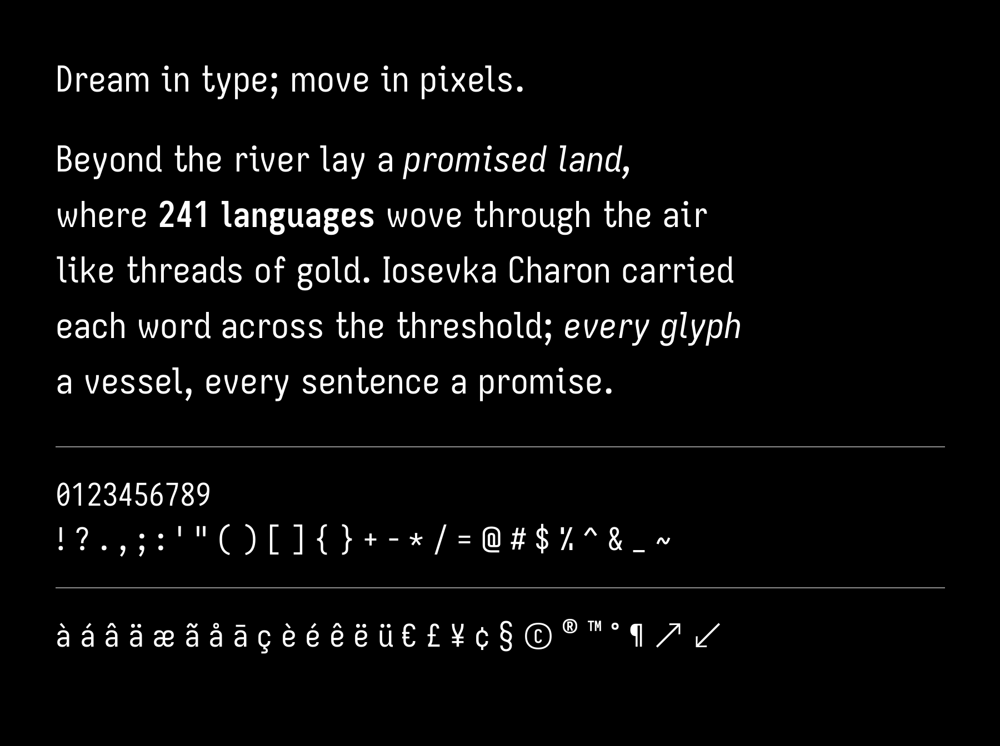
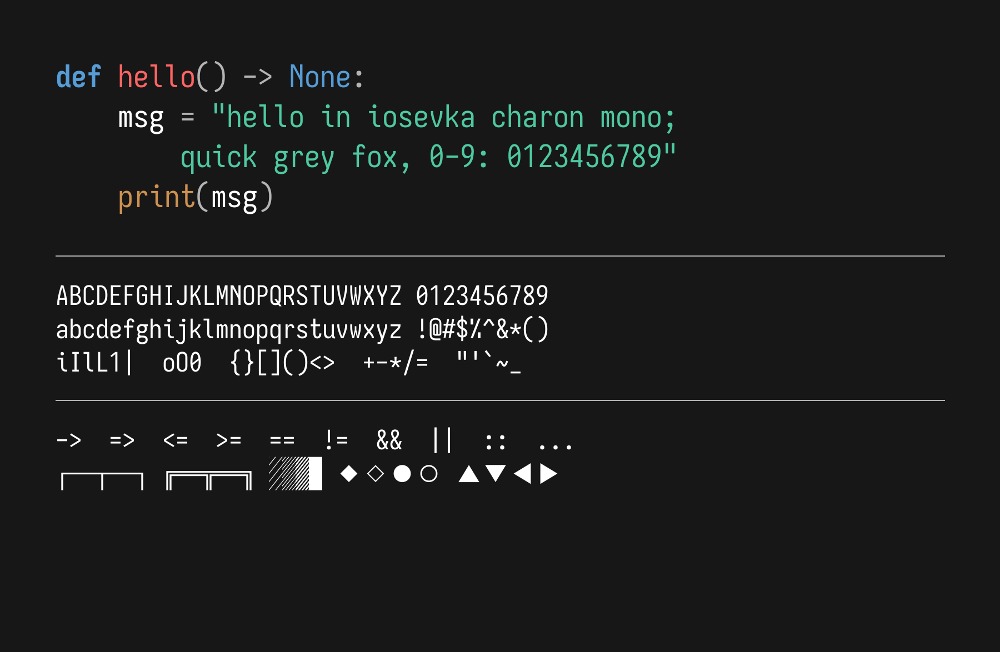
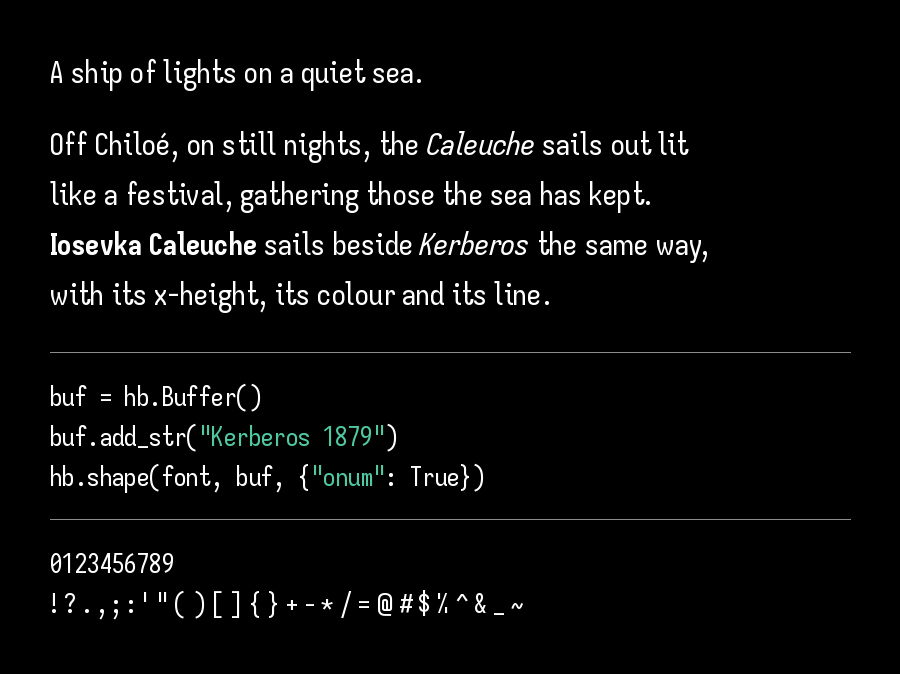

# Iosevka Charon

Iosevka Charon is a quasi-proportional font excellent for technical writing and dense UI. Iosevka Charon Mono is a true monospace font tuned for coding and terminal use. These font families are unique derivatives of [Iosevka](https://github.com/be5invis/Iosevka) (an open source font project) by [be5invis](https://github.com/be5invis); built in a manner that makes them Google Fonts compliant.

## Iosevka Caleuche

Iosevka Caleuche is Iosevka Charon re-proportioned to pair with [Kerberos](https://github.com/jul-sh/Kerberos), a Dutch-baroque text serif. It follows Kerberos 1.4.2's proportions, including each weight and style's own x-height and cap height, ascenders at 741 and descenders at −233 per 1000 em, the same default line height (1.205) and the same underline. It comes in Light, Regular, Medium and Bold, the same weights as Charon, and its italics lean 14.3° to match Kerberos's italic. Caleuche keeps Charon's letterform choices and its existing width setting.

Iosevka Caleuche also comes as variable fonts that keep that shared x-height at every size, one for each weight and style in `fonts/iosevkacaleuche/variable/`. They carry two of Kerberos's axes: optical size (`opsz`, 8–72), which grows the x-height below 20 pt as Kerberos's does, and lowercase height (`YTLC`, 500–550). Browsers set the optical size from the font size on their own (`font-optical-sizing: auto`), so set side by side the two still meet:

| Regular roman x-height (per 1000 em) | 8 pt | 12 pt | 14 pt | 16 pt | 20 pt and up |
| --- | --- | --- | --- | --- | --- |
| `YTLC` 500 (default) | 515 | 495 | 485 | 477 | 461 |
| `YTLC` 550 | 525 | 513 | 507 | 507 | 507 |

The static fonts use Kerberos's drawn proportions at optical sizes of 20 pt and up. For text below 20 pt, use the variable fonts for both families with `font-optical-sizing: auto`; apply the same `YTLC` value to both if you change it. Caleuche follows the 8, 12, 14, 20 and 72 pt masters, including Kerberos's weight mapping for Medium; heights are rounded to whole font units. Its default optical size is 14 pt, like Kerberos's.

The reference metrics are pinned to [Kerberos 1.4.2](https://github.com/jul-sh/Kerberos/tree/c813af0fd5ccda50c4beffebb5ea4029aad8e1a6) in [`sources/caleuche-kerberos.json`](sources/caleuche-kerberos.json), so building Caleuche does not require a Kerberos checkout or a network lookup.

Iosevka builds at another x-height do not interpolate with these, so [`scripts/caleuche_variable.py`](scripts/caleuche_variable.py) derives the taller lowercase from each static, the way Kerberos derives its own: the x-height zone stretches while capitals, ascenders, descenders and every advance width stay, accents and dots ride along, and mark positioning follows. The variable fonts are unhinted, like Kerberos's.

Download Caleuche from [`iosevka-caleuche.zip`](https://github.com/jul-sh/iosevka-charon/releases), separate from the Charon downloads. It contains static TrueType fonts in `fonts/iosevkacaleuche/`, matching `opsz`/`YTLC` variable TrueType fonts in `fonts/iosevkacaleuche/variable/`, and WOFF2 webfonts in `webfonts/{full,latin-ext,latin}/iosevkacaleuche/` (with variable webfonts in each subset's `variable/` directory). The `iosevka-charon.zip` and `iosevka-charon-webfonts.zip` downloads contain only Charon and Charon Mono.

The name comes from Caleuche Chasma, a canyon on Pluto's moon Charon named after the ghost ship of Chiloé.

241 Supported Languages:

Abkhazian, Afar, Afrikaans, Aghem, Akan, Akoose, Albanian, Anii, Aragonese, Armenian, Asturian, Asu, Atsam, Azerbaijani, Bafia, Baluchi (bal_latn), Bambara, Basaa, Bashkir, Basque, Belarusian, Bemba, Bena, Betawi, Bosnian, Breton, Bulgarian, Caddo, Catalan, Cebuano, Central Atlas Tamazight, Chechen, Chickasaw, Chiga, Chinese (zh_latn), Choctaw, Church Slavic, Chuvash, Colognian, Cornish, Corsican, Croatian, Czech, Danish, Duala, Dutch, Embu, English, Erzya, Esperanto, Estonian, Ewe, Ewondo, Faroese, Filipino, Finnish, French, Friulian, Fula, Ga, Galician, Ganda, German, Greek, Guarani, Gusii, Haitian Creole, Hausa, Hawaiian, Hindi (Latin), Hungarian, Icelandic, Ido, Igbo, Inari Sami, Indonesian, Interlingua, Interlingue, Inuktitut (iu_latn), Irish, Italian, Javanese, Jju, Jola-Fonyi, Kabuverdianu, Kabyle, Kaingang, Kako, Kalaallisut, Kalenjin, Kamba, Kara-Kalpak, Kazakh, Kenyang, Kikuyu, Kinyarwanda, Konkani (kok_latn), Koyra Chiini, Koyraboro Senni, Kpelle, Kurdish, Kuvi, Kwasio, Kyrgyz, Kʼicheʼ, Lakota, Langi, Latgalian, Latin, Latvian, Ligurian, Lingala, Lithuanian, Lojban, Lombard, Low German, Lower Sorbian, Luba-Katanga, Lule Sami, Luo, Luxembourgish, Luyia, Macedonian, Machame, Makhuwa, Makhuwa-Meetto, Makonde, Malagasy, Malay, Maltese, Manx, Mapuche, Masai, Meru, Metaʼ, Mi'kmaw, Mohawk, Moksha, Mongolian, Morisyen, Mundang, Muscogee, Māori, Nama, Navajo, Ngiemboon, Ngomba, Nheengatu, Nigerian Pidgin, North Ndebele, Northern Frisian, Northern Sami, Northern Sotho, Norwegian, Norwegian Bokmål, Norwegian Nynorsk, Nuer, Nyanja, Nyankole, Obolo, Occitan, Oromo, Ossetic, Papiamento, Pijin, Polish, Portuguese, Prussian, Quechua, Riffian, Romanian, Romansh, Rombo, Rundi, Russian, Rwa, Saho, Samburu, Sango, Sangu, Sardinian, Scottish Gaelic, Sena, Serbian, Shambala, Shona, Sicilian, Sidamo, Silesian, Skolt Sami, Slovak, Slovenian, Soga, Somali, South Ndebele, Southern Sami, Southern Sotho, Spanish, Sundanese, Swahili, Swati, Swedish, Swiss German, Tachelhit (shi_latn), Taita, Tajik, Taroko, Tasawaq, Tatar, Teso, Tok Pisin, Toki Pona, Tongan, Tsonga, Tswana, Turkish, Turkmen, Tuvinian, Tyap, Ukrainian, Upper Sorbian, Uzbek, Vai (vai_latn), Venda, Venetian, Vietnamese, Volapük, Vunjo, Walloon, Walser, Warlpiri, Welsh, Western Frisian, Wolof, Xhosa, Yakut, Yangben, Yoruba, Zarma, Zhuang, Zulu

## Building and testing

Clone via `git clone --depth 10 --branch main https://github.com/jul-sh/iosevka-charon.git` to avoid downloading the entire upstream history.

The Make targets rely on the Nix flake dev shell, which not only bootstraps the Python venv but also supplies the native toolchain required to build the fonts (e.g., Node, ttfautohint, and Git). If Nix is installed, `make` automatically enters the flake dev shell; when Nix is absent but Docker is available, the same flow runs inside the official `nixos/nix` container. With either tool installed, you can rely solely on the standard GNU Make entry points:

- `make build` – enter the Nix shell, build the fonts.
- `make test` – validate built fonts for Google Font compliance.
- see the Makefile for more details.

## Tooling

- Nix flake in `flake.nix` (root) provisions Node, Python with all font processing packages, native build tools (like ttfautohint), and other supporting dependencies.
- `sources/iosevka` is a git subtree containing the upstream Iosevka sources and Iosveka Charon build plan.
- `scripts/` contains scripts for building, and post processing to achieve Google Fonts compliance.

## Repository layout

- `sources/` – Iosevka subtree, build plans → `unprocessed_fonts/`
- `scripts/` – build script and google fronts post-processing script that transform `unprocessed_fonts/` → `fonts/`
- `fonts/` – Google Fonts TTFs created by `make build` (gitignored)
- `out/` – QA reports and proofs from `make test` / `make proof` (gitignored)
- `documentation/` – specimen assets (from the Google Fonts template)
- `flake.nix` – Nix development environment configuration

## License

Code, build tooling, and documentation are licensed under the MIT License (see
`LICENSE`). The font files remain under the SIL Open Font License 1.1 (see
`OFL.txt`).
